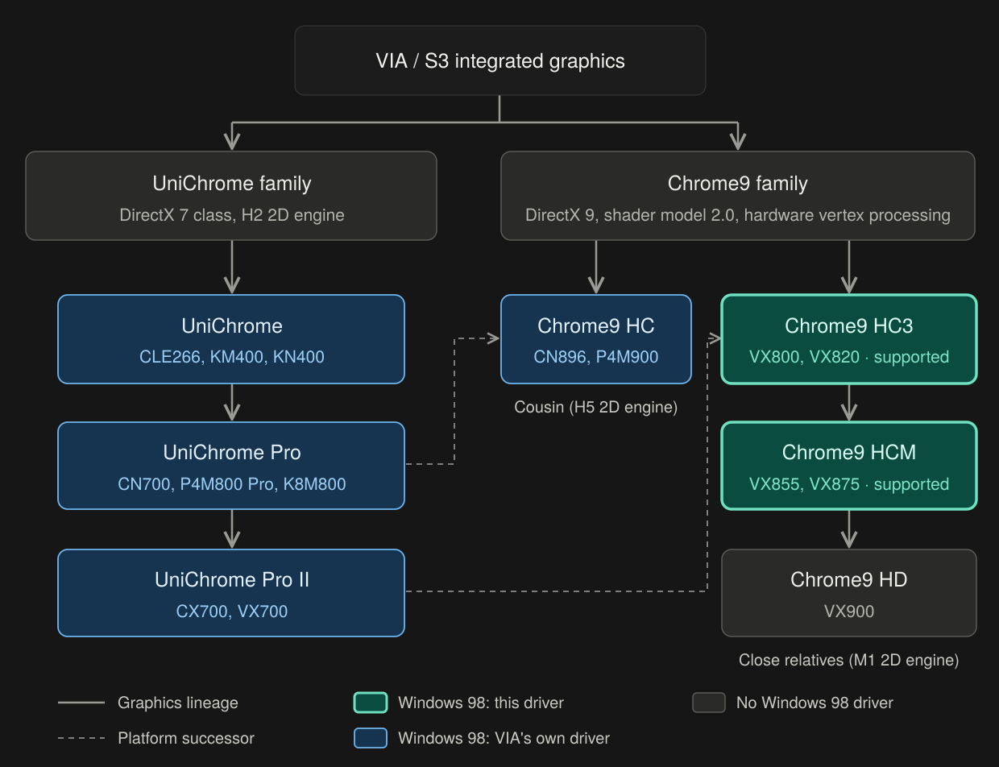
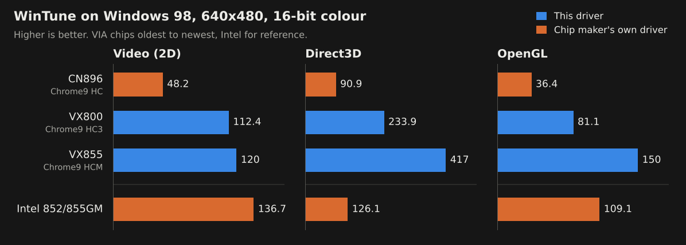

# VIA Chrome9 display driver for Windows 98 (VX800 / VX855)

A from-scratch Windows 98 display driver for the VIA VX800 and VX855 integrated graphics: accelerated 2D, DirectDraw, Direct3D and OpenGL from one set of files. VIA never shipped a Windows 9x driver for these chips.

Current build: **.597**

**Support the project:** if this driver is useful to you, you can [donate through PayPal](https://www.paypal.com/donate/?hosted_button_id=45HAEA4K4KTXU).

## Supported hardware

| Chipset | Graphics | PCI ID | What works |
|---|---|---|---|
| VX800 / VX820 | Chrome9 HC3 | 1106:1122 | 2D, DirectDraw, Direct3D, OpenGL, video overlay |
| VX855 / VX875 | Chrome9 HCM | 1106:5122 | 2D, DirectDraw, Direct3D, OpenGL, video overlay |

**Not supported: VX900 (Chrome9 HD, 1106:7122).** Windows 98 itself does not start on either VX900 board tried (a Gigabyte M7V90PI and an HP board), so nothing could be tested and the INF does not list it.

## Where these chips sit in VIA's line-up



VIA's integrated graphics come in two families. This driver covers two members of the newer one.

**UniChrome family** (DirectX 7 class, older 2D engine), oldest first:

1. UniChrome: CLE266, KM400, KN400
2. UniChrome Pro: CN700, P4M800 Pro, K8M800
3. UniChrome Pro II: CX700, VX700

**Chrome9 family** (DirectX 9 class, vertex processing in hardware), oldest first:

1. Chrome9 HC: CN896, P4M900. A cousin of the chips below: the same 3D core, but an older 2D engine with a different register layout.
2. Chrome9 HC3: VX800, VX820. **Supported.**
3. Chrome9 HCM: VX855, VX875. **Supported.**
4. Chrome9 HD: VX900. Not supported yet.

The last three are close relatives: they share the newer 2D engine and the same display core, which is why one set of driver files serves the VX800 and the VX855. As platforms, the CN896 followed the UniChrome Pro boards and the VX800 followed the CX700 and VX700.

**How the chips compare.** The upper rows come from published specifications, and several are unverified; the lower rows are measured results. The memory figures are theoretical peaks, shared with the processor.

| | CX700 | CN896 | VX800 | VX855 | VX900 |
|---|---|---|---|---|---|
| Graphics core | UniChrome Pro II | Chrome9 HC | Chrome9 HC3 | Chrome9 HCM | Chrome9 HD |
| 3D class | DirectX 7, no hardware T&L | DirectX 9, shader model 2.0 | DirectX 9, shader model 2.0 | DirectX 9, shader model 2.0 | DirectX 9, shader model 2.0 |
| Peak fill rate | about 200 Mpixels/s | about 500 | similar (not published; 250 MHz engine clock) | about 500 (not published) | similar (not published) |
| Shared memory, peak | DDR2-533, about 4.3 GB/s (unverified) | DDR2-667, about 5.3 GB/s | DDR2-667, about 5.3 GB/s | DDR2-800, about 6.4 GB/s | DDR3-1066, about 8.5 GB/s |
| Video decode | MPEG-2 | MPEG-2, partial H.264 | MPEG-2, MPEG-4, WMV9, VC-1 | H.264, VC-1, MPEG-2/4 | ChromotionHD 2.0 |
| 3DMark05, published results | needs DirectX 9 hardware | about 300 to 350 | none found | none found | about 700 to 760 |
| 3DMark06, published results | needs DirectX 9 hardware | about 100 to 125 | none found | none found | about 290 to 300 |
| WinTune Direct3D, Windows 98, 640x480 16-bit | not tested | 90.9 (VIA's driver) | 233.9 (this driver) | 417 (this driver) | not tested |
| **3D uplift over the chip before it** | baseline | **about +150%** (fill rate on paper) | **about +157%** (WinTune Direct3D) | **about +78%** (WinTune Direct3D) | not measured against the VX855; about +120% over the CN896 (3DMark05) |

The 3DMark and WinTune rows are measurements, not specifications, and the uplift row is worked out from them: each chip against the one in the column to its left. The CN896-to-VX800 step compares VIA's driver with this one on different boards, so part of that gain is the driver, not the chip. The 3DMark figures are typical stock results from the HWBOT database, run under Windows XP or later on different processors (the CN896 results mostly on much faster desktop processors than the VX900 ones). The WinTune row is from the Benchmarks section below: three different boards, and VIA's driver on the CN896.

What that means for Windows 98 games:

- **The big step is from UniChrome to any Chrome9 chip:** about 2.5 times the fill rate, plus hardware vertex processing.
- **The Chrome9 chips are the same class on paper but not the same speed.** Published 3DMark results put the VX900 at more than twice the CN896, and on this driver the VX855 scores about 1.8 times the VX800 in WinTune's Direct3D and OpenGL tests.
- **The processor often matters more than the graphics chip.** A VIA Nano is roughly 1.5 to 2 times a C7 or Eden at the same clock, and games of this era lean heavily on the processor.

The specification rows are there to set expectations. This driver's own measured figures are in the Benchmarks section.

**Other chips.** The CN896 and P4M900 are not supported. A port would be possible, since the 3D core and most display registers carry over, but it needs a second 2D register layout, an older pixel-clock encoding and per-chip display FIFO values. VIA's own Windows 98 driver exists for that chip, and it is the one measured in the benchmarks.

## What it does

- **2D (GDI):** engine fills, screen copies, pattern and hatch fills, lines, text, 1-bit and colour bitmap blits, ROP blits that read the screen, with solid, dithered and bitmap brushes. Anything the engine cannot draw exactly goes to Windows' own DIB engine, so the picture is always the one Windows would have drawn.
- **DirectDraw:** hardware blits, stretches, colour keys, page flipping with vertical sync, and a video overlay with scaling.
- **Direct3D:** a DirectX 7 hardware device (textures, blending, fog, depth and stencil).
- **OpenGL:** an installable client driver built on Mesa 7.0.3, with the chip's 3D engine doing the drawing and Mesa's software path covering what the chip cannot.
- **Display modes:** 8, 16 and 32 bits per pixel; the driver sets its own mode timings and reads the monitor's EDID.

## Requirements

- Windows 98 (Second Edition recommended).
- **DirectX 7 or later.** Tested with DirectX 9.0c. On DirectX 6.1 the desktop and 2D acceleration work, but DirectDraw and Direct3D are not hardware accelerated and OpenGL falls back to Microsoft's software renderer.
- More than 512 MB of memory needs the usual Windows 98 precautions (a memory limit in `SYSTEM.INI` or HimemX); that is Windows, not this driver.

## Installing

1. Unzip the driver files into one folder: `CHROME9.INF`, `CHROME9.DRV`, `CHROME9.VXD`, `VXDDRAW.DLL`, `VXGL.DLL`.
2. In Device Manager, open the display adapter, choose **Update Driver**, then **Have Disk**, and point it at that folder.
3. Pick the entry for your chip and restart when asked.

To update an existing install, replace the same five files and restart. All five must come from the same build.

## Files

| File | What it is |
|---|---|
| `CHROME9.DRV` | The 16-bit display driver Windows loads |
| `CHROME9.VXD` | The virtual device: mode setting, the 2D engine, the 3D command path |
| `VXDDRAW.DLL` | DirectDraw and Direct3D |
| `VXGL.DLL` | OpenGL |
| `CHROME9.INF` | Installation script |

## Checking an install

The test set is a separate download on the release page (`VIA_Chrome9_597_tools.zip`) and needs no games. Unpack it and double-click `RUNALL.BAT`; it runs the tests in order in a minimised window and gathers their reports in `tools\LOGS`. Do not move the mouse while it runs. VX2FLIP ends with a message box: press Enter.

| Tool | What it checks |
|---|---|
| VXREG | The build that is loaded, the chip found, DirectX version, whether DirectDraw uses the hardware |
| VX2GDI | 2D drawing against Windows' own, pixel for pixel, at 16, 32 and 8 bits |
| VXGTUNE | Lines, fills, text and bitmap blits: pixels and speed |
| VX2FLIP, VXFLIPF | DirectDraw blits, colour keys, page flips and their timing |
| VXDX7 | Direct3D |
| VXGL, VXSTEN, VXTEX | OpenGL scenes, stencil and textures, with the engine against software |
| VX2OVL | The video overlay (run by hand) |

A report that ends in PASS or `failures=0` is good. `LOGS\RUNALL.TXT` names the last test started if one hangs.

## Settings

The driver needs none. Two kinds of registry values exist under `HKEY_LOCAL_MACHINE\Software\VX85598`:

- logging switches for the OpenGL and Direct3D parts (`VXGL_LOG`, `ACCEL_D3D_LOG` and their sample-rate values), off by default
- `NOEDIDHIGHRES`, for monitors whose EDID should not limit the mode list

`VXREG` lists what the loaded driver reads.

## Benchmarks

WinTune 98 results at 640x480, 16-bit, in millions of pixels per second (higher is better):



| Machine and driver | Video (2D) | Direct3D | OpenGL |
|---|---|---|---|
| CN896 (Chrome9 HC), VIA's driver | 48.2 | 90.9 | 36.4 |
| VX800 (Chrome9 HC3), this driver | 112.4 | 233.9 | 81.1 |
| VX855 (Chrome9 HCM), this driver | 120 | 417 | 150 |
| Intel 852/855GM, Intel's driver | 136.7 | 126.1 | 109.1 |

The VIA rows run from the oldest Chrome9 chip to the newest; the Intel machine is listed last for reference.

How to read this: these are four different computers with different processors, and WinTune's video scores depend on the processor as well as the graphics chip and driver. Against VIA's own driver on the older CN896, both boards on this driver are ahead in all three tests. The Intel machine has the highest 2D score. In Direct3D both boards on this driver are well ahead of it. In OpenGL the VX855 is ahead of it and the VX800 behind. So the table shows roughly where this driver stands beside the chip makers' own Windows 98 drivers for neighbouring hardware; it is not a controlled comparison, and there is no vendor driver for the VX800 or VX855 to compare against directly.

## Known limits

- DirectX 6.1 and earlier: no hardware DirectDraw or Direct3D (see Requirements).
- Blits from an 8-bit DIB section with a ROP are drawn by Windows, not the engine.
- The video overlay has not been tested at 256 colours on the VX800.
- The second display output is not set up by the driver. In testing it mirrors the first display on its own; an independent second display (extended desktop) is not supported.

## Building from source

The source builds on Linux with Open Watcom:

```
python3 build.py --watcom <path to Open Watcom>
```

The driver files land in `driver/`, map files in `build/`. `python3 verification/verify.py` runs the compiled-code checks. `BUILDING.md` has the details, and `PASSDOWN.md` the current state of the work.

## Documentation

In the `docs` folder of the source:

- `COOKBOOK.md`: "VX855 Win98: building every proven function from scratch". How every part of the driver works, the rules found on real hardware, and the approaches that failed.
- `Chrome9_HC3_HCM_HD_programming_research.md`: programming research across the VX800, VX855 and VX900, drawn from VIA's manuals, OpenChrome and analysis of VIA's Windows CE and XP drivers.
- `VX800_VX855_VX900_XP_comparison.md`: how VIA's XP drivers differ between the three chips, with Windows CE cross-checks.

## Licence and sources

See `LICENSE` for the licence terms and `SOURCES.md` for the references the driver was built from. The OpenGL part builds on Mesa 7.0.3, which carries its own licence in `gl/mesa/COPYING`.

## Donate

This driver is free. If you want to support the work: https://www.paypal.com/donate/?hosted_button_id=45HAEA4K4KTXU
